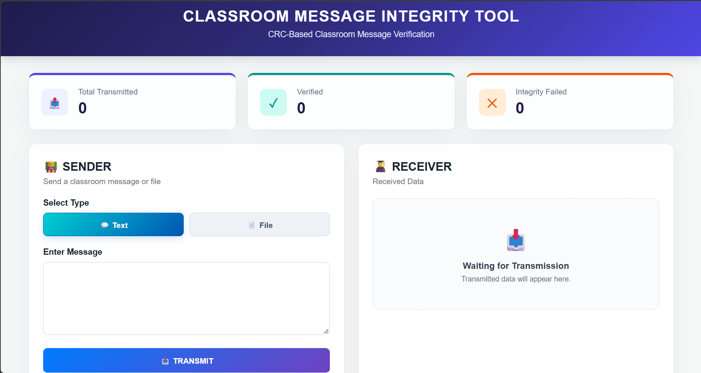

# CLASSROOM MESSAGE INTEGRITY TOOL

A browser-based application that demonstrates data integrity verification using the CRC-32 (Cyclic Redundancy Check) algorithm.

The application simulates the transmission of classroom announcements and files between a sender and receiver to identify accidental data modifications.

## Features

- **CRC-32 Checksum Generation:** Calculates CRC-32 checksums for text messages and uploaded files.
- **Sender and Receiver Simulation:** Simulates data transmission between two panels.
- **Error Injection:** Allows users to introduce changes to received data.
- **Integrity Verification:** Compares sender and receiver checksums.
- **Live Statistics:** Displays total transmissions, verified messages and integrity failures.
- **Transmission History:** Maintains a record of previous verification activities.
- **Responsive Dashboard:** Provides an interactive and user-friendly interface.

## Technologies Used

- HTML5
- CSS3
- JavaScript (Vanilla JavaScript)
- CRC-32 Algorithm

## How It Works

1. Enter a classroom message or upload a file.
2. The application calculates the sender-side CRC-32 checksum.
3. Transmit the data to the receiver panel.
4. Optionally click Create Error to simulate data corruption.
5. Calculate the receiver-side CRC-32 checksum.
6. Compare both checksum values.
7. View the verification result.

## Verification Results

| Condition | Result |
|---|---|
| Data received without modification | MATCHED |
| Data modified during simulated transmission | NOT MATCHED |

## How to Run the Project

1. Download or clone this repository.
2. Open the project folder.
3. Open `Index.html` in Google Chrome or another modern web browser.
4. Start testing text messages and file uploads.

No backend or database installation is required.

## Project Objective

The objective is to demonstrate how CRC-32 detects accidental data corruption through checksum comparison.

## Limitations

- The application simulates transmission locally in the browser.
- It does not perform actual network communication.
- CRC-32 detects accidental changes but does not provide cryptographic security or protection against intentional tampering.

## Future Enhancements

- Add automated testing.
- Display CRC values in hexadecimal format.
- Introduce real client-server communication.
- Improve verification and error-handling features.

---

**Project:** Classroom Message Integrity Tool  
**Developed using:** HTML5, CSS3 and JavaScript  
**Algorithm:** CRC-32
## 📸 Project Screenshots

### 1. Dashboard

### 2. Successful Text Verification

### 3. Failed Text Verification

### 4. Successful File Verification

### 5. Failed File Verification
